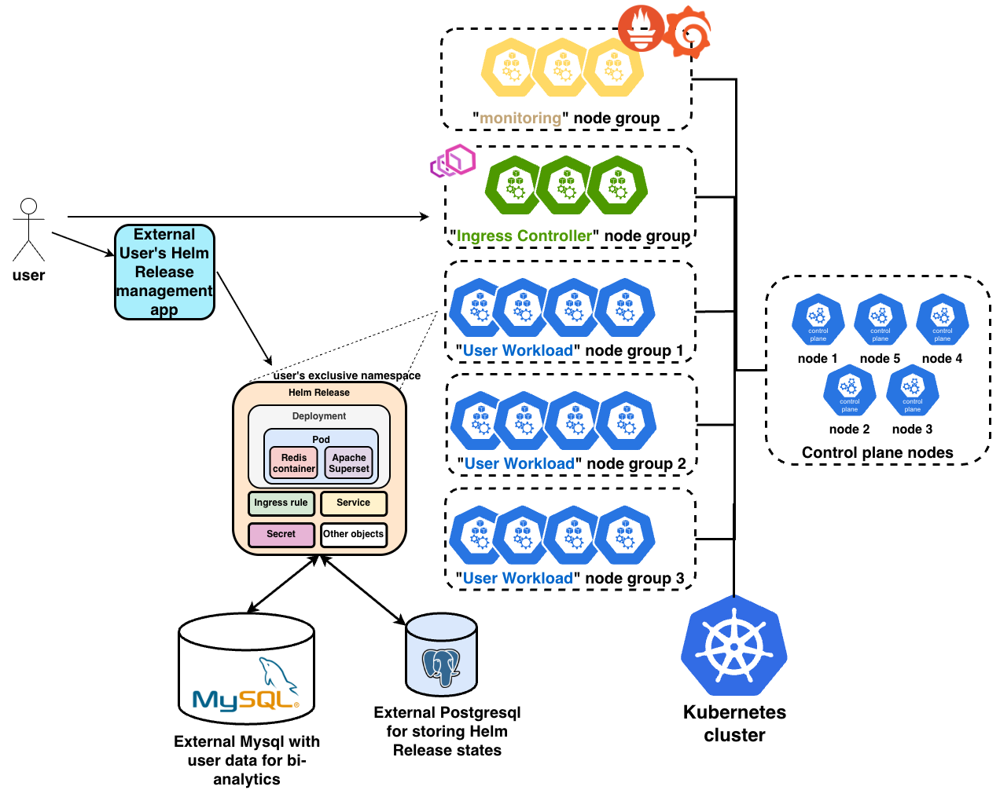
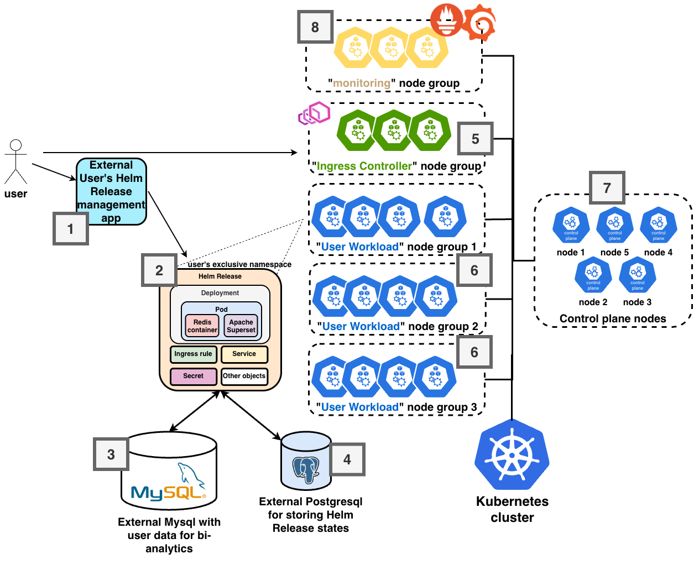
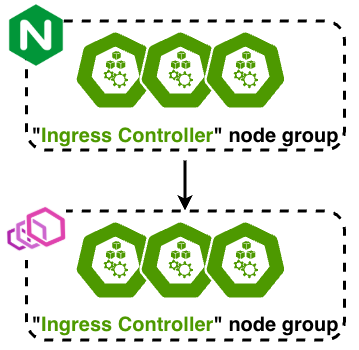
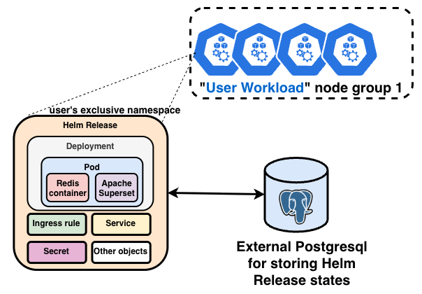
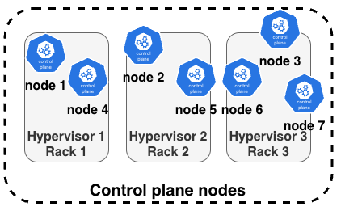
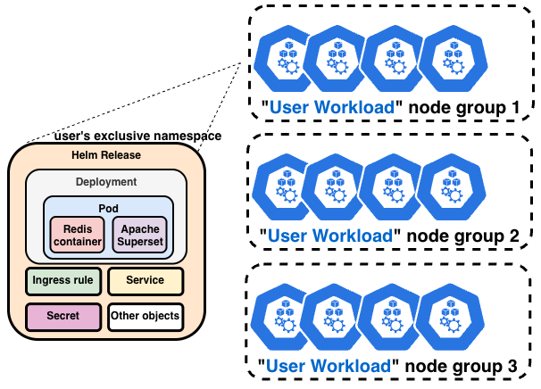
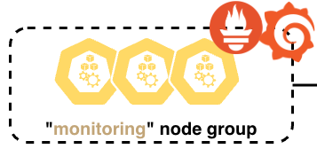

| **Active Tenants** | **Cluster Metadata** | **Peak Onboarding** | **L7 Ingress Scale** |
| :---: | :---: | :---: | :---: |
| **25,000+ Namespaces** | **150,000+ K8s Objects** | **1,000–3,000 Users / Day** | **50M-Line `nginx.conf` $\rightarrow$ Envoy** |

---

### Executive Overview

In a standard SaaS web application, supporting **25,000 active enterprise tenants** is a solved problem, typically translating to 25,000 rows in a shared PostgreSQL cluster and a handful of stateless worker pods. 

But what happens when, to guarantee strict compute and data isolation for an embedded Business Intelligence (BI) analytics engine (Apache Superset + Trino), an engineering team provisions **an isolated Namespace and a dedicated Helm Release for every single customer**?

The cluster math quickly turns adversarial:
* **Per-Tenant Object Multiplication:** Every active customer spawns 1 Namespace, 1 Deployment, 1 ReplicaSet, 1 Pod (`512MB` Apache Superset container + `64MB` Redis sidecar), 1 Service, 1 Ingress rule, and application Secrets/ConfigMaps ($\approx$ **10–13 Kubernetes objects per user**).
* **The Helm Revision Multiplier:** By default, Helm v3 stores release state as a gzipped, base64-encoded Kubernetes `Secret` inside `etcd`. Pushing post-launch hotfixes via `helm upgrade` while retaining revision history (`v1`, `v2`, `v3`) for rollbacks and A/B testing caused 25,000 tenants to snowball into **70,000+ Helm Secrets** and **150,000+ total Kubernetes objects**.
* **The Onboarding Surge:** Instead of the forecasted 20–30 signups per day, viral adoption hit **1,000–3,000 new tenants per day**, injecting up to 30,000 new API objects daily into a ~250-node cluster (~2,000 vCPUs, 4TB RAM) and breaking upstream Kubernetes sizing assumptions.

This paper is an architectural post-mortem of how we re-engineered the L7 routing layer, the `etcd` control plane, KVM hypervisor placement, and cluster autoscaling to survive this workload in production.

### Contents

- **[I. The Context: Architectural Trade-Offs Under a 6-Month Deadline](#i-context)**  
  *Stateless Trino/MySQL data pipelines, why per-user Helm releases happen in the real world, and the target topology.*
- **[II. The Data Plane Nightmare: From a 50-Million-Line `nginx.conf` to `contour-envoy`](#ii-dataplane)**  
  *Why `ingress-nginx` froze at 5,000 tenants, isolating routing onto tainted node groups, and streaming routes in $O(1)$ via Envoy xDS.*
- **[III. Control Plane Architecture: Resolving the 70,000-Secret Bottleneck and Tuning the Master Nodes](#iii-controlplane)**  
  *Zero-downtime migration to `HELM_DRIVER=sql` (PostgreSQL), Raft consensus physics, stripping static pod limits, and 1:1 hypervisor rack anti-affinity.*
- **[IV. Managing the Worker Fleet: Partitioned Node Groups, Pre-Warmed Autoscaling, and Observability](#iv-managing)**  
  *Bypassing HPA, absorbing 3,000 daily signups with `PriorityClass` pause pods, and fighting alert fatigue with component SLIs.*
- **[V. Proving the Architecture: Hyperscale Benchmarking with `clusterloader2`](#v-proving)**  
  *Why `k6` fails on asynchronous control planes, and benchmarking ~250 nodes / 20,000+ namespaces to >99.99% API availability.*
- **[VI. Retrospective: How I Would Architect This in Kubernetes 1.35 (2026)](#vi-retrospective)**  
  *Wildcard Gateway API dynamic routing, In-Place Pod Vertical Scaling, Scale-to-Zero, and sharding `etcd` with Virtual Clusters (`vCluster`).*
- **[VII. Conclusion and Key Takeaways](#vii-conclusion)**
- **[VIII. Sources & References](#viii-sources)**

## I. The Context: Architectural Trade-Offs Under a 6-Month Deadline

The client at the center of this case is a massive B2B SaaS provider, essentially the equivalent of Salesforce for the CIS, Latin American, and African emerging markets, serving millions of businesses.

Their product goal was ambitious: launch an embedded, customizable BI analytics suite that allowed enterprise customers to join core CRM tables (leads, deals, contacts) with external data sources (ClickHouse, MySQL, S3, Google Sheets) and render complex dashboards instantaneously rather than taking ten minutes. Crucially, the business operated on a strict **6-month release cycle**. Five of those months were spent by the client's R&D team building and validating the application architecture; with one month left before launch, they brought the finished design to our cloud platform team to deploy at scale. As a Cloud Solutions Architect, you don't get the luxury of telling a client to rewrite five months of R&D, you have to understand the trade-offs of what they built and engineer the underlying infrastructure to survive it.

### 1. The Stateless Data Pipeline: Why Keeping State Out of Kubernetes Worked

Whether to run stateful databases inside Kubernetes remains one of the most debated topics in infrastructure engineering. In this case, keeping the primary data stores outside the Kubernetes cluster was completely justified.

The new BI service did not generate primary business data; it acted as an analytical lens over petabytes of existing customer data that already lived in the client's battle-tested **MySQL** clusters. Migrating legacy relational databases into Kubernetes StatefulSets just for a visualization service would have introduced massive operational risk for zero benefit.

Instead, the client assembled a stateless data pipeline out of existing open-source components:

* **Filtered JSON Extraction:** Rather than duplicating entire databases, the core CRM portal exposed an internal API that extracted only requested columns, filters, and time ranges from MySQL as lightweight JSON payloads.

* **In-Memory OLAP Joins via Trino:** For the dashboard UI, the client selected **Apache Superset**. However, Superset is primarily a visualization layer (using SQLAlchemy to generate queries) and cannot natively join tables across disparate data sources. Rather than writing a custom query engine from scratch under a 6-month deadline, they placed **Trino**, a distributed, read-only, in-memory ANSI SQL OLAP engine, between MySQL and Superset. In just a few days, they wrote a custom Trino plugin that pulls the raw JSON slices from the CRM portal, parses them into in-memory SQL tables, caches them, and executes high-speed joins across tens of thousands of tenants.

**The Open-Source Trade-Off:** Building a complex platform by snapping together battle-tested open-source blocks (Trino + Superset) was the only realistic way to hit a 6-month deadline while avoiding commercial vendor lock-in. Of course, relying on upstream open-source in enterprise architecture carries its own modern risks, as the industry has repeatedly seen with corporate relicensing rugs (such as Terraform prompting the OpenTofu fork, Elasticsearch leading to OpenSearch, or Redis changing its license). Because both Trino and Apache Superset operate under the permissive Apache 2.0 foundation model, licensing lock-in was mitigated, leaving only the operational trade-off: the client owned the maintenance of the glue code and the deployment topology.

### 2. Why One Helm Release per User? (From `minikube` to Production)

While a single shared Trino cluster could serve tens of thousands of companies concurrently, Apache Superset became the multi-tenancy bottleneck. Superset was architected as an internal company BI tool, not a multi-tenant SaaS engine. Stuffing 25,000 unrelated enterprise organizations into a single shared Superset instance meant risking cross-tenant cache leaks, complex RBAC synchronization, and noisy-neighbor OOM (Out of Memory) kills whenever one user ran an unoptimized report.

Furthermore, when the client tried installing Superset directly on virtual machines, they hit severe Python and C library dependency conflicts. Containerizing the application solved the dependency hell immediately. They packaged Superset alongside a Redis cache sidecar into a Docker Compose stack, tested it inside **`minikube`** on a developer's laptop, and wrapped it into a **Helm chart**.

From an application developer's perspective, provisioning **one isolated Helm release per customer** looked like a silver bullet:

* **Hard Tenant Isolation:** Each customer gets an isolated Pod with strict cgroup resource boundaries (`512MB` RAM for Superset, `64MB` RAM for the Redis sidecar) and dedicated credentials.
* **Predictable Capacity Math:** Because pod requests and limits are fixed per user, calculating cluster compute requirements and configuring Kubernetes autoscaling becomes linear math.
* **Effortless Lifecycle & A/B Testing:** Rolling out a new version, testing a canary feature for a subset of customers, or rolling back a broken update is reduced to a single command: `helm upgrade` or `helm rollback`.

In 99% of Kubernetes clusters, Helm's architecture is invisible because engineers only deploy 10 to 50 Helm releases per cluster. Nobody notices that Helm v3 serializes the entire chart manifest, values, and metadata into a heavy Kubernetes `Secret` stored directly in `etcd`, or that it creates a brand-new `Secret` for every single revision (`v1`, `v2`, `v3`) unless explicitly pruned. What works smoothly on `minikube` for 10 test users becomes a ticking time bomb at 25,000 users.

### 3. The Forecast Miss and the "Managed Kubernetes" Illusion

When the client approached us to launch the service, their product team projected an initial adoption rate of **20 to 30 new tenants per day**. At 25 new charts a day, a standard 3-master control plane (`8 vCPUs`, `16GB RAM` per master) with `20GB` `etcd` disks would have coasted effortlessly, especially since SaaS feature launches typically see an initial week-one spike before plateauing.

Even more critically, the client viewed "Managed Kubernetes" as an infinite abstraction layer, later noting in their public case study:

> *"For us, Managed Kubernetes became the ideal solution, the cloud provider takes on all administration tasks, and we are freed from the need to look under the hood of Kubernetes and work with master nodes and controller managers."*

When launch day arrived, two things happened simultaneously:

1. **Viral Onboarding:** Instead of 20–30 users a day, demand exploded to **1,000–3,000 new enterprise tenants per day**, rapidly scaling past **25,000+ active tenants**.
2. **Continuous Hotfix Churn:** As happens in every major software launch, real-world usage exposed missing options and edge-case bugs. The client's engineering team began pushing frequent hotfixes across the user base via `helm upgrade`. Every hotfix wave multiplied the number of release-state `Secrets` stored in `etcd`, rocketing past **70,000+ secrets** and **150,000+ total Kubernetes objects**.

Under this combined onslaught of API object creation and monolithic Ingress updates, the default cluster configuration buckled.

### 4. The Target Architecture Overview

To stabilize the platform without forcing the client to rewrite their application mid-launch, we re-engineered the cluster into the segmented, high-throughput architecture shown below.

Here is how the end-state architecture operates from left to right, following the numbered components on the diagram:

1. **External Helm Release Management App (`[1]`):** A Python Flask orchestrator built by the client. When a business user clicks "Activate BI Analytics" on the main CRM website, this service invokes the Kubernetes API and `helm` CLI to provision that tenant's stack, and iterates over existing tenants with `helm upgrade` during application rollouts.
2. **User's Exclusive Namespace & Helm Release (`[2]`):** The per-tenant isolation unit. Each release deploys a Pod (`512MB` Apache Superset container + `64MB` Redis sidecar), a `Deployment`, `ReplicaSet`, `Service`, `Ingress` rule, and application `Secrets`.
3. **External MySQL Cluster (`[3]`):** The client's established transactional database holding years of customer CRM records. Data is extracted on demand as filtered JSON via Trino into the stateless Superset pods, keeping persistent user data completely outside Kubernetes.
4. **External PostgreSQL for Helm State (`[4]`):** Our managed PostgreSQL PaaS cluster. To stop Helm's revision history from blowing up `etcd`, we reconfigured the client's Helm orchestrator to use Helm's SQL storage driver (`HELM_DRIVER=sql`), migrating **70,000+ Helm release state secrets** out of Kubernetes and into PostgreSQL.
5. **Dedicated "Ingress Controller" Node Group (`[5]`):** A tainted, isolated group of worker nodes fronted by an OpenStack Octavia LoadBalancer-as-a-Service (LBaaS). Initially running the standard `ingress-nginx` PaaS add-on (which collapsed under a 50-million-line config at 5,000 users), this layer was migrated to **`contour-envoy`** and isolated so surging user pods could never starve the cluster's entry point.
6. **Partitioned "User Workload" Node Groups (`[6]`):** Multiple autoscaling worker node groups (`Node Group 1..3`) that scaled up to **246 worker nodes** (~2,000 vCPUs and 4TB RAM total across the cluster), utilizing pre-warmed buffer capacity to absorb spikes of 3,000 new users per day.
7. **Dedicated Control Plane Nodes (`[7]`):** A heavily tuned 5-to-7 node Master ring running on dedicated hypervisors with 1:1 CPU pinning, single-AZ rack anti-affinity, dual High-IOPS SSD `etcd` disks, and stripped static pod resource limits. (Because our OpenStack Magnum PaaS state machine did not allow adding master nodes in-place without risking state corruption, scaling the control plane horizontally required migrating the live cluster via **Velero**, a complex operation that deserves an article of its own.)
8. **Dedicated "Monitoring" Node Group (`[8]`):** An isolated node group running the **Prometheus and Grafana** stack (`kube-prometheus-stack`), ensuring that control-plane telemetry, `etcd` WAL latency metrics, and real-time alerts remained online even when user workload nodes reached 100% saturation.

In the sections that follow, we will look at each of these architectural zones, examining the exact reasons of why they broke at hyperscale and how we engineered them to survive.

## II. The Data Plane Nightmare: From a 50-Million-Line nginx.conf to contour-envoy

When the client originally designed their platform for an expected 20 to 30 new tenants per day, choosing the default **`ingress-nginx`** controller was the most rational engineering decision available.

In our Kubernetes PaaS, `ingress-nginx` was offered as a turnkey, out-of-the-box **Managed Add-on**. The cloud platform automatically provisioned the controller, wired it to an external OpenStack Octavia LoadBalancer (running active-standby HAProxy instances with VRRP failover), and handled version upgrades. In a typical production Kubernetes cluster, an Ingress controller manages anywhere from a dozen to a few hundred `Ingress` rules. Even if the client had onboarded 30 users a day for two weeks, managing ~400 virtual host rules in `ingress-nginx` would have been completely effortless.

Then the cluster collided with the reality of **1,000 to 3,000 new tenants per day**, and at **5,000 active tenants**, the L7 routing layer suffered a total outage.

### 1. The 5,000-Tenant Outage: Why `ingress-nginx` Collapsed

Because every tenant environment was deployed as an isolated Helm release with its own unique domain, every new customer signup created a separate Kubernetes `Ingress` resource.

Under the hood, the community `ingress-nginx` controller operates on a monolithic file-generation model. While it uses Lua (`lua-resty-balancer`) to dynamically update existing pod IP endpoints without reloading, **adding a new `Ingress` virtual host (`server {}` block) still requires rewriting the entire `nginx.conf` file to disk and triggering a process reload**.

At 5,000 tenants, the generated `nginx.conf` had ballooned to **50 million lines of configuration**. Every time a new customer clicked "Activate BI Analytics":

1. The Go controller inside the `ingress-nginx` pod had to serialize the entire cluster routing state into a 50-million-line text file on disk.
2. It executed `nginx -t` to parse and validate syntax across all 50 million lines.
3. It issued a `SIGHUP` (`nginx -s reload`) to the master NGINX process, which re-parsed the massive configuration into memory and forked a brand-new set of worker processes while keeping the old worker processes alive in a "shutting down" state to drain existing connections.

This created a catastrophic compounding failure:

* **Controller Reload Timeouts:** The `ingress-nginx` controller enforces an internal timeout when waiting for `nginx -t` and `nginx -s reload` to complete. Once parsing 50 million lines exceeded that timeout threshold, the controller aborted the reload subprocess. New `Ingress` rules could no longer be applied, meaning the Python Flask provisioning app timed out waiting for new tenant URLs to become reachable, halting all new user onboarding.
* **The Fleet-Wide `helm upgrade` Trap:** Even worse, consider the client's update strategy. Whenever they pushed a chart update across thousands of tenants via `helm upgrade` that touched an Ingress annotation or routing parameter, it queued thousands of sequential config reloads, turning a simple deployment into hours of routing gridlock.
* **Memory Doubling:** Whenever overlapping reloads occurred, the Linux kernel held multiple generations of forked NGINX worker processes in RAM simultaneously, each holding a copy of the 50-million-line routing table, triggering violent OOM-kills.

### 2. Step 1 - Isolating the Resources (Dedicated Node Group & Taints)

Before we could replace the underlying proxy engine, we had to stop the bleeding in production. Initially, Ingress pods shared worker capacity or ran with default add-on resource limits (`limits.cpu` / `limits.memory`).

In a cluster onboarding thousands of users daily, allowing tenant workloads (`Apache Superset` + `Redis` pods) to schedule on the same nodes as the Ingress controller is a fatal anti-pattern. If a sudden wave of new user pods consumes the remaining CPU and RAM on those nodes, two things happen:

1. The Ingress pods are starved of CPU cycles exactly when they need to burst to parse configurations and terminate TLS.
2. When traffic spikes and the Ingress deployment attempts to scale out additional replicas, the Kubernetes scheduler hits an `Insufficient CPU/Memory` wall, preventing the Ingress layer from scaling and locking *both* new and existing users out of the platform.

To guarantee routing sovereignty, we re-architected the placement topology:

* **Dedicated Autoscaling Node Group:** We provisioned a dedicated **`"Ingress Controller" node group`** backed by the Cluster Autoscaler.
* **Strict Taints & Tolerations:** We applied Kubernetes `taints` (`dedicated=ingress:NoSchedule`) and matching `nodeSelector`/`tolerations` to the Ingress deployment, physically barring user workloads from ever landing on routing nodes.
* **Stripping Pod CPU Limits:** We removed hard CPU limits on the Ingress pods, allowing the proxy processes to burst across 100% of the dedicated nodes' physical cores during heavy traffic and configuration updates.

### 3. Step 2 - The Architectural Cure: Migrating to `contour-envoy`

Isolating the nodes bought us breathing room, but it didn't change the fundamental computer science problem: **$O(N)$ monolithic file parsing on disk cannot scale when $N = 25,000$ tenants**.

While commercial **NGINX Plus** (Enterprise) introduces dynamic APIs for upstream management, truly solving high-churn, multi-tenant virtual host routing required abandoning config-file proxies entirely in favor of an API-driven data plane. We guided the transition from `ingress-nginx` to **Project Contour (`contour-envoy`)**.

Written in C++, **Envoy** was architected from day one for cloud-native multi-tenancy. Instead of reading a static text file from disk, Contour separates the ingress layer into a **Control Plane (Contour)** and a **Data Plane (Envoy)** communicating over a persistent, bidirectional **gRPC stream using the xDS (Discovery Service) protocol**:

* **Dynamic In-Memory Streaming (`RDS` & `EDS`):** When the client's Flask app provisions tenant #25,001, Contour watches the Kubernetes API, updates its internal Directed Acyclic Graph (DAG), and streams *only the delta* via the **Route Discovery Service (RDS)** directly into Envoy's memory.
* **Zero Reloads, $O(1)$ Insertion:** Envoy inserts the new virtual host route in real time without touching the disk, without validating a 50-million-line text file, and without forking new Linux worker processes. New customers became routable in milliseconds rather than minutes.

**The Architectural Trade-Offs of Choosing Envoy:**
Was `contour-envoy` a silver bullet? In terms of data-plane performance and reload elimination, yes, it effortlessly carried the cluster past 25,000+ tenants. However, as a Solutions Architect, you always have to weigh the operational trade-offs:

1. **Losing the "Managed Add-On" Safety Net:** Unlike `ingress-nginx`, which was natively integrated into our PaaS add-on lifecycle manager (`magnum-addons`), `contour-envoy` was not an out-of-the-box cloud add-on at the time. Moving to Contour meant transitioning the Ingress controller from a provider-managed service to a client-managed workload, requiring custom Helm lifecycle management and manual upgrade validation during Kubernetes version bumps.
2. **Control-Plane DAG Memory Footprint:** Because Contour maintains a live in-memory DAG of 25,000+ routes and streams state over gRPC to Envoy pods, its baseline memory footprint is higher than a static proxy. Keeping `contour-envoy` strictly isolated inside our tainted, autoscaled `"Ingress Controller" node group` ensured this memory overhead remained completely predictable and insulated from the rest of the cluster.

With the L7 data plane stabilized and onboarding unblocked, the full force of those 1,000–3,000 daily signups slammed straight into the next bottleneck: **the Kubernetes Control Plane and `etcd`**.

## III. Control Plane Architecture: Resolving the 70,000-Secret Bottleneck and Tuning the Master Nodes

Once the L7 routing layer was stabilized with `contour-envoy`, the bottleneck shifted to the Kubernetes control plane. With 1,000 to 3,000 new tenants onboarding daily and frequent application updates rolling out across the fleet, the control plane had to track over 150,000 Kubernetes objects, including more than **70,000 `Secret` resources**.

To keep the cluster stable without halting customer onboarding, we had to address four distinct control-plane challenges: offloading Helm state storage from `etcd`, balancing horizontal and vertical master scaling under Raft consensus constraints, removing static pod cgroup limits, and isolating the master virtual machines on dedicated physical hypervisors.

### 1. Offloading 70,000 Helm Secrets to External PostgreSQL

In a standard Kubernetes environment, Helm v3 defaults to storing release metadata inside the cluster itself (`HELM_DRIVER=secret`). Every time `helm install` or `helm upgrade` is executed, Helm serializes the rendered chart templates, values, and state into a gzipped, base64-encoded JSON blob and writes it as a Kubernetes `Secret` (`type: helm.sh/release.v1`). Crucially, to enable instant rollbacks (`helm rollback`) and A/B version testing, Helm retains up to 10 historical release revisions per deployment by default.

At 25,000 active tenants, just two or three application hotfix waves (`helm upgrade`) across the customer base generated over **70,000 large Helm `Secret` objects** inside `etcd`. This created severe control-plane pressure:

* **`etcd` Storage Quota & Memory Bloat:** Because `etcd` maps its underlying B+Tree data store into memory via `mmap`, tens of thousands of megabyte-scale secret revisions rapidly pushed `etcd` toward its backend storage quota (`--quota-backend-bytes`) and inflated resident memory usage.
* **API Server Watch-Cache Overhead:** The `kube-apiserver` maintains an in-memory watch cache and serializes object state over gRPC. Churning 70,000 secrets during fleet-wide upgrades caused sustained CPU and memory spikes across the API servers.

**The Zero-Downtime Migration Strategy:**
Rather than forcing the client to abandon Helm or lose their release history, we reconfigured their Python Flask management service to use Helm's native SQL storage driver (`HELM_DRIVER=sql`), pointing it to an external managed **PostgreSQL** cluster.

We executed the migration online in three phases without pausing customer deployments:

1. **Throttled State Extraction (Read-Only):** We wrote a migration script to query the existing `sh.helm.release.v1.*` secrets from the Kubernetes API and insert them into the PostgreSQL backend. Because reading secrets via `kube-apiserver` is a pure read operation, it avoided expensive Raft write consensus in `etcd`. However, to prevent overwhelming the API server with massive unpaginated `LIST` serialization, the extraction was executed sequentially in rate-limited chunks rather than aggressive parallel threads.
2. **Backend Cutover:** Leveraging `etcd`'s strong consistency, once the historical state was synchronized, the client switched their provisioning application's environment configuration to `HELM_DRIVER=sql`, immediately routing all new user signups and `helm upgrade` operations to PostgreSQL.
3. **Rate-Limited `etcd` Cleanup:** Finally, we purged the 70,000 legacy Helm secrets from Kubernetes. Because a `DELETE` in `etcd` is actually a Raft write operation that appends an MVCC tombstone (requiring subsequent compaction and defragmentation to reclaim space), deletions were throttled in controlled batches.

### 2. `etcd` Physics: Raft Consensus and Vertical vs. Horizontal Scaling

To handle the remaining 80,000+ active workload objects (`Pods`, `Deployments`, `ReplicaSets`, `Services`, `HTTPProxies`), we had to scale the control plane itself. This required balancing the trade-offs of the **Raft consensus algorithm** used by `etcd`.

`etcd` provides strong consistency (a CP system in CAP theorem terms) by electing a single **Leader** node that handles all write requests, while **Follower** replicas duplicate the state log. For any write transaction (creating a pod, updating an endpoint) to be committed, the Leader must stream the log entry to all followers and wait for a strict majority quorum, $\lfloor N/2 \rfloor + 1$ nodes, to write the entry to disk and acknowledge it.

This architecture creates an inherent tension between horizontal and vertical scaling:

* **Why Horizontal Scaling Has Diminishing Returns:** Adding more master nodes increases read capacity (as `kube-apiserver` instances can distribute read/watch load) and improves fault tolerance (a 3-node cluster tolerates 1 failure; a 5-node cluster tolerates 2; a 7-node cluster tolerates 3). However, **horizontal scaling degrades write latency**. Increasing the cluster from 3 to 7 masters means the Raft leader must wait for 4 nodes instead of 2 to confirm every write. Furthermore, inter-node Raft heartbeats, health checks, and full-mesh `kube-apiserver`-to-`etcd` gRPC streams scale quadratically ($O(N^2)$ connection paths), increasing network chatter (`etcd_network_peer_sent_bytes_total`) and CPU serialization overhead.
* **Why Vertical Scaling Was Essential:** Because a single Raft leader serializes all writes, increasing write throughput requires faster single-node CPU performance, more RAM, and lower disk I/O latency, not more nodes.

Because our OpenStack Magnum PaaS used a declarative state-machine orchestrator that did not support adding new master VMs to an existing `etcd` ring in-place (and manual database manipulation risked breaking cluster reconciliation), expanding the topology from 3 to 5, and ultimately **7 master nodes**, required provisioning a parallel cluster and migrating workloads via **Velero**. Within that 5-to-7 node topology, we relied heavily on vertical scaling (`STD3-16-64` flavors: 16 vCPUs, 64GB RAM per master).

### 3. The Static Pod Limit Paradox

When we first vertically scaled the master virtual machines in our PaaS to larger CPU and RAM flavors, the control plane continued to suffer from API slowdowns and container restarts.

Investigating the node telemetry revealed an architectural flaw in how the PaaS managed control-plane static pods (`kube-apiserver`, `etcd`, `kube-controller-manager`, `kube-scheduler`). When a cluster was initially provisioned on smaller default flavors (e.g., 4 vCPUs, 8GB RAM), the static pod manifests in `/etc/kubernetes/manifests/` were generated with hardcoded Kubernetes resource `limits` matching that initial flavor. When the underlying OpenStack VM was resized to 16 vCPUs and 64GB RAM, the static pod manifests were not dynamically recalculated, meaning `kube-apiserver` and `etcd` were still throttled by the Linux kernel's cgroup CPU CFS quota and OOM-killed against their old memory ceilings while 80% of the host VM's RAM sat idle.

**The Trade-Off of Removing Control-Plane Pod Limits:**
Initially, we considered maintaining a lookup table to map VM flavors to static pod limits. However, during a viral launch onboarding up to 3,000 users a day, the load profile shifts unpredictably between `etcd` (during heavy state churn), `kube-apiserver` (during Helm watch bursts), and `kube-scheduler` (during batch pod creation). Any static partitioning of RAM between those four components inevitably leaves resources stranded.

Instead, we made the architectural decision to **completely remove `limits` from all control-plane static pods** (`kube-apiserver`, `etcd`, `kube-controller-manager`, `kube-scheduler`), allowing them to burst freely across 100% of the master VM's CPU and RAM.

* **The Risk:** Stripping container limits removes cgroup blast-radius isolation on the host; a memory leak or a runaway API request flood in `kube-apiserver` can exhaust host memory and trigger the Linux kernel OOM-killer against `etcd`.
* **The Mitigation:** Because the master VMs were dedicated exclusively to the control plane (enforced via `node-role.kubernetes.io/control-plane:NoSchedule` taints) and could be vertically resized on demand, treating the control plane like bare-metal system daemons was the most pragmatic choice. To guard against host exhaustion, we paired unlimited static pods with dual-layer alerting: cloud-level hypervisor alerts at 80% VM CPU/RAM utilization, and in-cluster Prometheus alerts tracking component error rates and API latencies.

### 4. Engineering "Bare-Metal" Isolation on OpenStack/KVM

Because OpenStack Magnum provisions Kubernetes nodes as Nova virtual machines rather than raw physical servers, we had to eliminate the "virtualization tax" on the hypervisor layer to give our 7 master VMs bare-metal performance and fault tolerance.

1. **Single-AZ Rack Anti-Affinity:** At the time, our PaaS did not support stretching a control plane across multiple Availability Zones (AZs), and even if it had, cross-datacenter network RTT increases Raft quorum latency (`peer_round_trip_time_seconds`). Operating within a single datacenter (`MS1`), our primary physical risk was a Top-of-Rack (ToR) switch outage or a physical host failure. Using OpenStack Nova `ServerGroups` with anti-affinity placement policies (`scheduler_hints`), we distributed the 7 master VMs across at least **3 separate dedicated physical hypervisors located in different server racks** (with a `2 + 2 + 3` distribution across Racks 1, 2, and 3). Even in the worst-case failure of Rack 3 (losing 3 master VMs simultaneously), **4 master nodes remain online across Racks 1 and 2**, preserving the minimum 4-node Raft quorum ($\lfloor 7/2 \rfloor + 1 = 4$) required to keep the cluster operational without interruption.
2. **Dedicated Hypervisors & Zero Oversubscription (1:1 Allocation):** Standard public cloud hypervisors rely on CPU oversubscription (often 4:1 or higher) and shared memory pools. For a latency-sensitive database like `etcd`, CPU steal time (`%st`) from noisy neighbors causes missed Raft heartbeats and leader election instability. We isolated the control plane onto dedicated physical hypervisors with **CPU and RAM oversubscription completely disabled (1:1 allocation)**, ensuring `etcd`'s memory-mapped pages and `kube-apiserver` threads had guaranteed physical resources.
3. **Dual High-IOPS Disks & Splitting `etcd-events`:** `etcd` write throughput is strictly bounded by disk `fsync` latency (`wal_fsync_duration_seconds`). In a cluster churning 30,000 objects a day, Kubernetes generates a massive stream of transient `Event` objects (pod scheduled, image pulled, container started). If `Events` are written to the same `etcd` instance as core cluster state (`Pods`, `Secrets`, `Deployments`), event write bursts saturate disk I/O and block critical state operations.
    * **Architectural Split:** We deployed **two separate `etcd` instances per master node**, attaching **two dedicated Cinder volumes** (`vdb` for primary `etcd`, `vdc` for `etcd-events`) backed by High-IOPS iSCSI SSD RAID-1 storage shelves.
    * **Capacity-Based IOPS Over-Allocation:** In our cloud storage layer, maximum volume IOPS scaled linearly with provisioned disk capacity (GB). Even though `etcd-events` and core metadata only consumed a fraction of the disk space (often sitting around 10% utilization), we intentionally provisioned oversized High-IOPS SSD volumes (`8GB+` / `20GB+` tiers) strictly to unlock higher storage QoS IOPS ceilings, ensuring WAL `fsync` latencies remained flat under peak onboarding spikes.

## IV. Managing the Worker Fleet: Partitioned Node Groups, Pre-Warmed Autoscaling, and Observability

While the control plane and L7 ingress required architectural changes to handle metadata volume, the worker fleet faced a different challenge: **burst capacity provisioning and bin-packing efficiency**.

Unlike a traditional web service where traffic spikes cause the **Horizontal Pod Autoscaler (HPA)** to add replicas to an existing deployment, onboarding in this platform bypassed HPA entirely. Because every new customer provisioned a dedicated Helm release with fixed resource boundaries (`512MB` for Apache Superset and `64MB` for the Redis sidecar), capacity demand was driven directly by the **`kube-scheduler`**. Whenever a wave of new signups arrived, the scheduler attempted to place the new pods. Once existing worker nodes ran out of allocatable memory, pods entered the `Pending` state, triggering the **Cluster Autoscaler** to request new virtual machines from the OpenStack Magnum API.

At a growth rate of 20 to 30 users per day, reactive node provisioning works invisibly. At **1,000 to 3,000 new users per day**, a naive single-group autoscaling setup breaks down.

### 1. Why One Node Group Wasn't Enough: Partitioning and Flavor Sizing

To support over 25,000 pods across **246 worker nodes** (~2,000 vCPUs and 4TB of RAM), we partitioned the compute layer into multiple **"User Workload" node groups** (`app`, `app-0`, `app-1`) rather than relying on a single monolithic scaling group. This design solved three operational constraints:

1. **Orchestrator and SDN Port Ceilings:** In OpenStack-based environments, scaling a single node group past 100 nodes introduces orchestration bottlenecks, and underlying SDN networks (such as legacy OpenStack Neutron before migrating to Sprut SDN) degrade when a single network segment exceeds 500 ports due to full-sync state storms. Capping individual node groups at 70 to 90 nodes (`90 + 80 + 70` in our benchmark topology) kept each group well below platform limits.
2. **Parallelizing Cloud Provisioning:** When the Cluster Autoscaler scales out across multiple node groups (configured with `--expander=least-waste` or `random`), provisioning requests are distributed across separate worker queues, reducing serial bottlenecks during burst scale-ups.
3. **Empirical VM Flavor Optimization (`STD3-4-16`):** Calculating the optimal VM flavor in advance is difficult when initial forecasts (30 users/day) are off by two orders of magnitude. Giant VMs (e.g., 32 vCPUs, 128GB RAM) reduce per-node `kubelet` and DaemonSet overhead, but create a large blast radius if a node fails and take longer to drain during upgrades. Tiny VMs fragment memory, leaving stranded 300MB pockets across hundreds of nodes that cannot fit a `576MB` tenant pod. Having multiple node groups allowed us to empirically test different CPU-to-RAM ratios under live onboarding traffic, converging on **`STD3-4-16` (4 vCPUs, 16GB RAM)** worker nodes as the sweet spot between high memory utilization, fast provisioning, and smooth scale-out increments.

### 2. The "Warm-Up" Overprovisioning Pattern (Zero-Wait Onboarding)

Even with optimized `STD3-4-16` nodes, standard Cluster Autoscaler behavior is **reactive**: it only requests a new VM *after* a pod fails to schedule and becomes `Pending`.

In an IaaS cloud, turning a `Pending` pod into a `Ready` Kubernetes node takes several minutes: OpenStack Nova must schedule the VM on a hypervisor, Cinder must attach the boot volume (`ceph-ssd`), the OS (AlmaLinux 9.2) must boot, `containerd` and `kubelet` must initialize, and Calico CNI must establish BGP/VXLAN networking. If 200 enterprise users click "Activate BI" simultaneously and hit a full cluster, making them wait 4 minutes for a VM to boot results in provisioning timeouts.

To achieve instantaneous pod scheduling while preserving cloud cost efficiency, we implemented **Cluster Overprovisioning ("Warm-Up" Buffer Nodes)** using Kubernetes `PriorityClass` preemption:

* **The Placeholder Pod:** Inside the worker node groups, we deployed large "placeholder" pods (running the lightweight `registry.k8s.io/pause` image) configured with resource `requests` roughly equivalent to an entire worker node's allocatable capacity, assigned a negative scheduling priority (`priorityClassName: overprovisioning`, value `-10`).
* **Instant Preemption on Spike:** Under steady state, this placeholder pod sits on a warm, booted worker VM, doing nothing. The exact second a burst of new tenant Helm releases arrives (running at default priority `0`) and exhausts existing nodes, `kube-scheduler` immediately **evicts (preempts) the low-priority placeholder pod**.
* **Asynchronous Background Scale-Out:** The real customer pods immediately claim the freed capacity on the warm VM and start in seconds. Meanwhile, the evicted placeholder pod enters the `Pending` state, which triggers the Cluster Autoscaler in the background to request a fresh Nova VM. By the time the current warm node fills up, the next warm buffer node has finished booting.

### 3. Isolating the "Brains" of Observability & Fighting Alert Fatigue

Monitoring a 250-node cluster requires separating **metric collection** from **metric ingestion and alerting**. To collect host-level telemetry across the fleet, lightweight agents (`prometheus-node-exporter` and `kubelet`/`cAdvisor`) must run on every single control-plane and worker node via DaemonSets. However, the heavy stateful "brains" of the monitoring stack, the **Prometheus TSDB server, Grafana, and Alertmanager**, require strict isolation.

If Prometheus and Alertmanager run on shared worker nodes, a sudden surge of user workloads or an OOM storm on the data plane can evict or starve the monitoring pods, blinding the engineering team at the exact moment an outage occurs. We isolated the `kube-prometheus-stack` into a dedicated, tainted **`"monitoring" node group`**, wiring Alertmanager directly to an operational **Telegram channel** (an instant-messaging escalation channel equivalent to Slack or PagerDuty) so engineers could react immediately during the launch window.

**Designing Actionable Alerts (Avoiding Alert Fatigue):**
A common failure mode in cloud operations is configuring static, theoretical alerts on Day 1 that do not reflect how the workload actually behaves in production. When alerts fire constantly over normal short spikes, they create noise in the messaging channel and engineers begin ignoring them, leading to missed catastrophic failures. Throughout the launch phase, we continuously tuned alert thresholds around two distinct tiers:

1. **Control Plane Survival SLIs (Component-Level Isolation):** Monitoring aggregate CPU and RAM on master VMs is insufficient; if a master node hits 90% RAM, you need to know instantly *which* component is misbehaving before it triggers a host-level OOM kill against `etcd`. We tracked granular component SLIs:
    * **`etcd` Storage & Consensus:** Disk WAL sync latency (`etcd_disk_wal_fsync_duration_seconds_bucket`), backend commit duration (`etcd_disk_backend_commit_duration_seconds_bucket`), peer-to-peer round-trip time (`etcd_network_peer_round_trip_time_seconds_bucket`), and leader election changes (`etcd_server_leader_changes_seen_total`).
    * **API Server & Scheduler Throughput:** P99 request latency (`apiserver_request_duration_seconds_bucket`), inflight long-running requests (`apiserver_longrunning_requests`), and scheduler backlog depth (`scheduler_pending_pods` / `scheduler_queue_incoming_pods_total`).
    * **Networking Sync:** `kube-proxy` rule synchronization latency (`kubeproxy_sync_proxy_rules_duration_seconds_bucket`) and 5xx client error rates.

2. **Worker Fleet & Autoscaler Health (Guarding Against Silent Failures):** Because each tenant pod had deterministic limits (`512MB` + `64MB`), individual pod resource usage was predictable, even though user signup volume was unpredictable. This meant we could rely on Cluster Autoscaler rather than manual "ClickOps" VM provisioning, *provided the autoscaler itself did not silently stall*. Cluster Autoscaler can fail to scale out if a node group hits its configured maximum size, if cloud project quotas are exhausted, or if an OpenStack VM gets stuck in an `ERROR` state during provisioning. We configured worker-tier alerts combining Kubernetes state metrics (`kube_pod_status_phase{phase="Pending"}` sustained beyond the warm-up window, `kube_node_status_condition{condition="Ready",status!="true"}`) with hardware-level `node_exporter` metrics (`node_memory_MemAvailable_bytes` and `node_cpu_seconds_total`) to verify that cluster capacity was scaling smoothly in lockstep with tenant demand.

## V. Proving the Architecture: Hyperscale Benchmarking with `clusterloader2`

By Day 3 of the rollout, as active tenant deployments crossed the 5,000 mark and daily onboarding showed no signs of slowing down, it became clear that reactive troubleshooting in production was unsustainable.

As noted earlier, the client had validated their Helm chart locally in `minikube` before launch, operating under the assumption that a "Managed Kubernetes" service would linearly absorb whatever workload was thrown at it. Had growth remained at the forecasted 20 to 30 users per day, that assumption would have held true. Instead, with thousands of tenants arriving daily, we needed empirical answers before the cluster hit 20,000+ users: *Where are the exact breaking points of our PaaS infrastructure, and which control-plane optimizations actually move the needle?*

Rather than guessing in production, we provisioned a dedicated, full-scale staging replica to systematically stress-test the control plane and validate our architectural changes.

### 1. Why `clusterloader2` Instead of `k6` or `Locust`?

When engineers think of load testing, they typically reach for HTTP/API protocol generators like **Grafana k6**, **Locust**, or **JMeter**. While `k6` is an exceptional tool for benchmarking stateless web APIs and L7 data-plane throughput, it is fundamentally the wrong instrument for stress-testing a Kubernetes control plane.

The limitation lies in how Kubernetes processes state:
* **The Asynchronous Reconciliation Gap:** If you point `k6` at `kube-apiserver` to create 20,000 Deployments, `k6` only measures the synchronous HTTP transaction, how long it takes the API server to validate the JSON payload and commit a record to `etcd` (often just 15–30ms). Once `kube-apiserver` returns `HTTP 201 Created`, `k6` marks the request as complete.
* **Invisible Downstream Strain:** In reality, committing the manifest to `etcd` is merely the starting gun. The real control-plane load happens *asynchronously* across multiple reconciliation loops: `kube-controller-manager` watches the Deployment and spawns a `ReplicaSet`; the ReplicaSet controller creates `Pod` objects; `kube-scheduler` evaluates node predicates across hundreds of worker VMs; `kubelet` initializes containers via `containerd`; and `kube-proxy` / Calico CNI synchronizes network routing rules across every node in the cluster.

Just as monitoring host-level VM CPU and RAM failed to tell us *which* control-plane pod was choking, pure HTTP load generators fail to correlate API request rates with internal controller queue depths, scheduler backlogs, or `etcd` disk sync latencies.

To get component-level visibility, we turned to **`clusterloader2`** (part of the official upstream `kubernetes/perf-tests` suite used by Kubernetes `sig-scalability`). Unlike stateless HTTP tools, `clusterloader2` is natively Kubernetes-aware:
1. **Declarative State Scenarios:** It executes multi-stage YAML test scenarios that declaratively ramp up namespaces, ConfigMaps, Secrets, and Deployments in controlled, iterative batches while simultaneously generating synthetic network traffic and scraping cluster `Events`.
2. **End-to-End Convergence SLIs:** Instead of timing raw HTTP responses, it establishes watches on the Kubernetes API to measure how long it takes for thousands of pods to transition from creation to `Running` (`PodStartupLatency`), directly exposing bottlenecks in `kube-scheduler` and `kube-controller-manager`.
3. **Automated Prometheus Telemetry:** With `--enable-prometheus-server=true`, `clusterloader2` automatically deploys an isolated Prometheus stack inside the test cluster to scrape internal metrics from `etcd`, `kube-apiserver`, `kube-scheduler`, and `kube-proxy` throughout the test run.

### 2. Designing the Replica Testbed and Iterative Methodology
To accurately model the client's 20,000+ tenant target state, we provisioned a dedicated benchmark cluster matching our proposed high-scale topology:

* **Control Plane:** **5 Master Nodes** running on `16 vCPU / 64GB RAM` flavors (`STD3-16-64`), each equipped with two separate High-IOPS volumes, separating the primary `etcd` data store from `etcd-events`.
* **Worker Fleet:** **~250 Worker Nodes** (`246 x STD3-4-16` instances: 4 vCPUs, 16GB RAM each) partitioned across three workload node groups (`90 + 80 + 70` nodes) plus a dedicated monitoring node group.

Following a structured load-testing methodology, we avoided dumping 20,000 workloads into the cluster all at once. Instead, we stressed the infrastructure in four distinct phases to isolate component limits:

1. **Iterative IaaS Node Scaling:** Provisioning and deleting worker nodes in progressively larger batches ($10 \rightarrow 50 \rightarrow 100 \rightarrow 200+$) to measure OpenStack IaaS provisioning throughput and baseline `etcd` peer-to-peer heartbeat overhead as node count grew.
2. **Stepped Namespace & Helm Pod Bursts:** Deploying tenant environments in stepped waves until the cluster sustained **~20,000 Namespaces, ~20,000 Deployments/ReplicaSets, and ~21,000 Running Pods**.
3. **Concurrent Event & Watch Saturation:** Continuously querying cluster `Events` across all namespaces while mutating objects to simulate heavy monitoring and Helm controller activity.
4. **Data-Plane Proxy Stress:** Generating concurrent traffic across deployed `Services` to measure `kube-proxy` iptables/IPVS rule synchronization latency (`kubeproxy_sync_proxy_rules_duration_seconds`) across ~250 nodes.

### 3. Benchmark Findings and Architectural Validation

Running this testbed at ~20,000+ namespaces and ~21,000+ pods yielded critical empirical proof for the optimizations we discussed in earlier sections, while satisfying upstream Kubernetes scalability SLOs:

| Subsystem / Metric | Observed Benchmark Behavior (~20k Namespaces / ~21k Pods) | Architectural Takeaway |
| --- | --- | --- |
| **API Server Availability & Latency** | **>99.99% Read/Write Availability**; P99 `GET` latency held flat at **~25ms** and `POST` latency at **~35ms** (well below the upstream 1s SLO). | Five `16 vCPU / 64GB` masters easily handle the API load once Helm secrets are offloaded and static pod CPU limits are removed. |
| **Control Plane Memory Footprint (No Limits)** | `kube-apiserver` stabilized at **~4.5GB RAM** per node; `etcd` resident memory held steady at **~2.5GB RAM**; `kube-controller-manager` used **~1.1GB RAM**. | Proved that **removing static pod resource limits was safe** under steady-state hyperscale load, components consumed predictable memory well within the 64GB host ceiling. |
| **`etcd` Disk Sync & Consensus** | Separating `etcd-events` onto a second High-IOPS disk kept primary WAL `fsync` duration flat at **10–25ms** with **zero unexpected leader elections**. | Confirmed that isolating transient `Event` I/O and over-allocating volume sizes for higher storage QoS IOPS prevents Raft consensus stalls. |
| **Worker Fleet & `kube-proxy`** | Aggregate worker CPU stayed under **~10%** and RAM around **~30%**, while `kube-proxy` synced rules across ~250 nodes with zero 5xx errors. | Validated the `STD3-4-16` worker flavor choice and confirmed that CNI/proxy sync remained healthy at ~250 nodes. |

**Why Benchmarking Improved Both the Client Cluster and Our Cloud PaaS:**
First, the benchmark gave us quantitative confidence that stripping cgroup limits from control-plane static pods would not cause spontaneous OOM crashes under the client's 20,000-namespace footprint, though we still retained strict Prometheus and host-level alerting in production, since synthetic tests cannot replicate every anomalous query or traffic spike a real user might trigger.

Second, these findings extended far beyond a single customer engagement. Prior to this case, customers using our Managed Kubernetes service had to manually choose master node counts and VM flavors based on general sizing guidelines we authored. The telemetry gathered from these `clusterloader2` runs provided the exact SLI baselines (`etcd` WAL latency thresholds, per-object memory curves, and disk IOPS profiles) required to re-engineer our PaaS defaults, paving the way toward **fully managed, auto-scaling control planes** where the cloud platform automatically sizes and splits `etcd` storage and scales master resources behind the scenes without requiring customers to guess their control-plane flavors.

## VI. Retrospective: How I Would Architect This in Kubernetes 1.35 (2026)

Any architectural retrospective requires an honest disclaimer: **the only architecture proven to survive production is the one you actually benchmarked and ran.** Moreover, as a cloud infrastructure provider, we operate under a strict boundary, we are not the client's application development team. While the most compute-efficient solution would be rewriting the BI platform into a natively multi-tenant application rather than spawning an isolated Apache Superset instance per customer, a cloud architect must work with the containers the client brings to the table.

Assuming the client's core requirement remains unchanged, running isolated Apache Superset and Redis containers per customer, how would we design this platform today using modern **Kubernetes 1.35** primitives?

### 1. L7 Routing: From Custom `contour-envoy` to Gateway API (and Dynamic Service Routing)

Looking back, migrating from `ingress-nginx` to **`contour-envoy`** was the single most impactful data-plane decision, and the broader Kubernetes ecosystem has since moved in the exact same direction. With the upstream Kubernetes community officially retiring `ingress-nginx` in favor of the **Gateway API**, Envoy-backed controllers have become the de facto standard for cloud-native routing.

However, it is worth asking critically: *Would switching from `Ingress` objects to Gateway API's `HTTPRoute` objects automatically solve the 25,000-tenant problem?*

On its own, no. While `HTTPRoute` provides cleaner, role-oriented multi-tenant delegation across namespaces, creating 25,000 individual `HTTPRoute` manifests still forces the control plane (`etcd` and the Gateway controller's DAG) to track 25,000 routing objects.

* **The Modern Optimization (Wildcard Gateway + Envoy Dynamic Routing):** Because every tenant namespace follows a deterministic naming convention (e.g., `tenant-<id>.bi.domain.com` routing to `superset-svc.tenant-<id>.svc.cluster.local`), we wouldn't need to register 25,000 separate routing rules in `etcd` at all. Using an Envoy-based **Gateway API** implementation with a single wildcard `HTTPRoute` (`*.bi.domain.com`) paired with a lightweight Envoy filter (`ext_proc` or embedded Lua/Wasm header-to-cluster extraction), Envoy can dynamically route incoming requests to the target namespace's `Service` directly from the HTTP `Host` header. This collapses **25,000 Ingress objects in `etcd` down to a single static Gateway route**, eliminating onboarding routing latency entirely.

### 2. Compute Efficiency: In-Place Pod Resizing vs. Idle Memory Waste

Provisioning 25,000 static pods with `512MB` Superset limits and `64MB` Redis sidecars represents over **14 TB of theoretical maximum memory allocation**. In reality, enterprise BI analytics is a bursty, daytime workload, thousands of tenants configure their dashboards once and only open them a few times a week.

At the time of our launch, Kubernetes pod resources were completely immutable: if you gave a Superset pod a tiny `128MB` limit to save RAM across the fleet, the first time a user ran a heavy report, the container would hit a cgroup OOM-kill and crash their dashboard. To guarantee a flawless user experience, the client had to assign generous `512MB` ceilings to every pod, relying on lower `requests` so they could overcommit worker nodes.

In **Kubernetes 1.35**, **In-Place Pod Vertical Scaling (Resource Resizing)** has graduated to stable, opening up two much cleaner patterns:

* **Dynamic Bursting via In-Place Resizing:** Instead of restarting pods to change their cgroup boundaries, an external controller or VPA can dynamically patch a running pod's memory `requests` and `limits` upward in place when active query load is detected. (Caveat: While scaling memory limits up in-place works seamlessly, scaling memory limits back down on Python/SQLAlchemy workloads like Superset is notoriously tricky because Python's heap allocator rarely releases fragmented pages back to the OS kernel, risking OOM kills if the cgroup limit is clamped down too aggressively).
* **Scale-to-Zero on Idle (KEDA / Knative):** Because the cluster is completely stateless (with all data living in external MySQL and Helm state in PostgreSQL), the most cost-effective enhancement alongside Envoy is **HTTP-driven Scale-to-Zero**. By placing an HTTP interceptor (such as KEDA's HTTP add-on) in the data path, inactive tenant deployments can scale down to `0` replicas overnight or after 30 minutes of inactivity, and spin back up in seconds on the pre-warmed worker nodes when a user opens their BI tab.

### 3. Sharding the Control Plane: Multi-Cluster vs. Virtual Clusters (`vCluster`)

Even after offloading 70,000 Helm secrets to PostgreSQL, forcing a single `etcd` Raft cluster to track 150,000+ objects for 25,000 namespaces pushes a single Kubernetes control plane to the edge of its maximum operational capacity. If we were designing this topology today to scale to 50,000 or 100,000 tenants, we would shard the control plane into smaller failure domains (e.g., **5,000 tenants per shard**).

There are two ways to architect this sharding, each with distinct trade-offs around **Ingress routing** and **Cluster Autoscaling**:

| Architectural Pattern | How `etcd` & Control Plane Scale | How Worker Nodes & Autoscaling Work | How Ingress Routing Works |
| --- | --- | --- | --- |
| **Option A: Hard Sharding (Multiple Physical PaaS Clusters)** | Each shard (5,000 tenants) is a completely separate Managed K8s cluster with its own small 3-node `etcd` ring. Zero cross-shard blast radius. | **Fragmented Compute:** Each cluster manages its own isolated worker node groups and its own `Cluster Autoscaler`, meaning you must maintain "warm-up" buffer VMs in *every* cluster, increasing idle cloud costs. | Each cluster runs its own Envoy Ingress group. The client's external portal Load Balancer / DNS routes `tenant-X` to the specific cluster VIP hosting that shard. |
| **Option B: Soft Control-Plane Sharding (`vCluster` on a Shared Host Cluster)** | We run one physical Host cluster, and deploy **5 isolated `vCluster` pods** inside it (each handling 5,000 tenants with its own dedicated `kube-apiserver` and isolated `etcd`/Postgres backing store). | **Unified Compute & Autoscaling:** `vClusters` do not own worker nodes. Their high-level objects (`Deployments`, `ReplicaSets`, `Secrets`, `ConfigMaps`) stay trapped inside the `vCluster`'s own database, while only the raw `Pod` specifications are synced down to the Host cluster. **A single Host `kube-scheduler` and a single `Cluster Autoscaler`** bin-pack all pods across one shared pool of 250 worker nodes. | The `vCluster` syncer projects tenant routing rules down to the Host cluster's single tainted **`contour-envoy`** node group, requiring only one shared Ingress fleet and one external Load Balancer. |

**Why `vCluster` Solves the Sharding Paradox:**
When engineers first consider splitting a giant cluster into smaller sub-clusters, the immediate operational headache is resource fragmentation: *Do we need separate worker node pools, separate warm-up buffers, and separate Ingress controllers for every sub-cluster?*

By using **Virtual Clusters (`vCluster`)**, we decouple **Control-Plane Metadata Sharding** from **Data-Plane Compute Pooling**. Each `vCluster` absorbs the heavy API churn and Helm metadata of 5,000 tenants in its own small, fast database index, while the underlying physical host cluster only sees flat `Pod` objects, allowing a single Cluster Autoscaler and a single Envoy Ingress fleet to manage the underlying virtual machines with maximum bin-packing efficiency.

## VII. Conclusion and Key Takeaways

Scaling Kubernetes to 25,000+ isolated tenant environments and 150,000+ objects on a 250-node cloud footprint is an exercise in respecting the physical boundaries of distributed systems. When a workload inverts standard Kubernetes assumptions, replacing a few large deployments with tens of thousands of miniature Helm releases, default configurations will fail.

Our key engineering takeaways from stabilizing this launch:

1. **Eliminate $O(N)$ Config Reloads in the Data Plane:** Traditional file-based proxies like `ingress-nginx` cannot survive high-churn multi-tenancy once `nginx.conf` reaches tens of millions of lines. Isolating the routing tier onto tainted node groups and migrating to an API-driven Envoy data plane (`contour-envoy` / Gateway API via xDS) is mandatory for real-time tenant onboarding.
2. **Keep High-Churn State Out of `etcd`:** Using `etcd` to store 70,000+ gzipped Helm release revisions will exhaust control-plane memory and watch caches. Offloading Helm state to an external SQL backend (`HELM_DRIVER=sql`) and splitting `etcd-events` onto dedicated High-IOPS block storage preserves Raft consensus stability.
3. **Strip Artificial Limits on Dedicated Control Planes:** Vertically scaling master VMs is pointless if static pod manifests remain throttled by legacy cgroup limits. On dedicated control-plane nodes backed by 1:1 hypervisor pinning and rack anti-affinity, removing static pod limits, paired with granular component SLI alerting, unlocks the full capacity of the hardware.
4. **Pre-Warm the Fleet and Benchmark with State-Aware Tooling:** Reactive autoscaling is too slow for spikes of 3,000 new users per day. Using `PriorityClass` pause-pod overprovisioning absorbs instant onboarding bursts, while state-aware benchmarking via `clusterloader2` proves exactly where control-plane bottlenecks hide before production traffic finds them.

(In a follow-up article, we will dive beneath the Kubernetes layer into the cloud provider control plane itself, explaining how our OpenStack Magnum PaaS state machine was architected, why declarative reconcilers forbid manual database interventions, and how this extreme production case drove the creation of automated, zero-downtime vertical scaling for Kubernetes master nodes.)

## VIII. Sources & References

* **Kubernetes Autoscaler Documentation:** [Cluster Autoscaler FAQ & Overprovisioning with Pause Pods](https://github.com/kubernetes/autoscaler/blob/master/cluster-autoscaler/FAQ.md)
* **Kubernetes Scalability & Performance Testing:** [`kubernetes/perf-tests` ,  ClusterLoader2 Framework](https://github.com/kubernetes/perf-tests/tree/master/clusterloader2)
* **Consensus & State Storage:** [The Raft Consensus Algorithm](https://raft.github.io/) & [etcd v3.4+ Operational Metrics Guide](https://etcd.io/docs/v3.4/metrics/)
* **L7 Routing & xDS Architecture:** [Project Contour (`contour-envoy`) Architecture](https://projectcontour.io/) & [Kubernetes Gateway API Specification](https://gateway-api.sigs.k8s.io/)